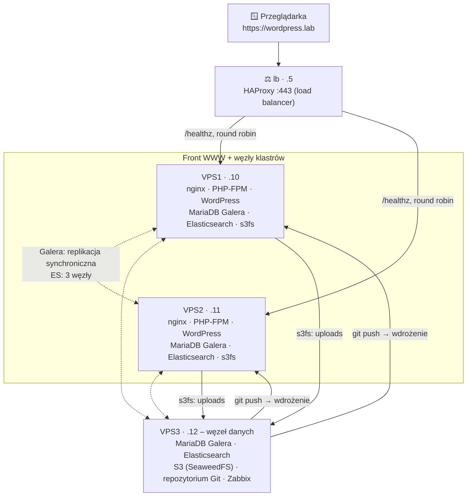
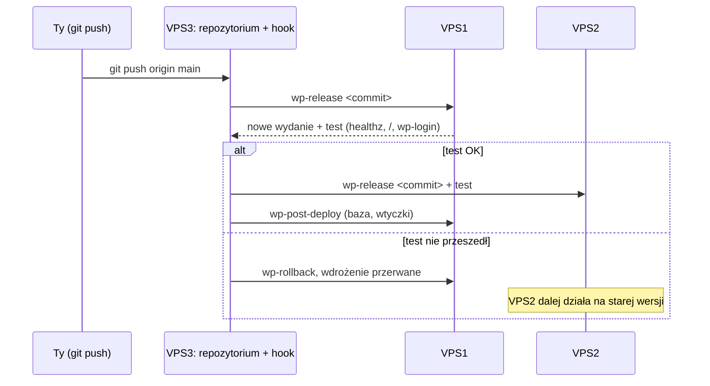

<div align="center">

# 🧪 WordPress HA Lab: HAProxy · nginx · PHP-FPM · MariaDB Galera · Elasticsearch · S3

**Domowe laboratorium środowiska WordPress wysokiej dostępności.**
4 maszyny wirtualne stawiane jednym poleceniem (Vagrant + Ansible), wdrożenia strony przez `git push`,
monitoring w Zabbixie i ćwiczenia z typowych awarii.


</div>

## Architektura



| Maszyna | IP | vCPU / RAM | Co działa |
|---|---|---|---|
| `lb` | 192.168.57.5 | 1 / 1 GB | HAProxy: HTTPS 443, health check `/healthz`, panel statystyk :8404 |
| `vps1` | 192.168.57.10 | 2 / 4 GB | nginx, PHP-FPM, WordPress, MariaDB Galera, Elasticsearch, s3fs → S3 |
| `vps2` | 192.168.57.11 | 2 / 4 GB | to samo co VPS1 |
| `vps3` | 192.168.57.12 | 2 / 6 GB | MariaDB Galera, Elasticsearch, S3 (SeaweedFS), repozytorium Git, Zabbix (PostgreSQL) |
| **Razem** | | **7 / 15 GB** | + ok. 60 GB na dysku |

### Wersje i zamienniki

| Element | W labie | Uwagi |
|---|---|---|
| Load balancer | HAProxy | TLS, health check, rozkład ruchu, panel statystyk |
| Magazyn S3 | SeaweedFS na VPS3 | darmowy serwer S3; MinIO od 10.2025 nie wydaje już gotowych binarek. s3fs działa z nim jak z każdym S3 |
| Elasticsearch | 9.x | linię wersji zmienia `es_repo_major` w `ansible/group_vars/all.yml` (np. `"8.x"`) |
| nginx, PHP, MariaDB | wersje z Debiana 13 (nginx 1.26, PHP 8.4, MariaDB 11.8) | pakiety systemowe |
| WordPress | najnowszy (plik `.wp-version` w repozytorium strony) | wersję zmienia się commitem, np. przypinając konkretny numer |

## Wymagania (Windows 11)

- procesor z wirtualizacją, **16 GB wolnego RAM**, ok. 60 GB wolnego miejsca na dysku SSD,
- [VMware Workstation](https://www.vmware.com/products/desktop-hypervisor/workstation-and-fusion) (darmowy do użytku prywatnego) **albo** VirtualBox,
- [Vagrant](https://developer.hashicorp.com/vagrant/install),
- dla VMware dodatkowo: [Vagrant VMware Utility](https://developer.hashicorp.com/vagrant/install/vmware) i wtyczka:

```powershell
vagrant plugin install vagrant-vmware-desktop
```

- Git dla Windows.

## Szybki start

```powershell
git clone https://github.com/programmingbygrzegorz/wordpress-galera-elasticsearch-lab.git
cd wordpress-galera-elasticsearch-lab
vagrant up --no-parallel        # VirtualBox: vagrant up --no-parallel --provider=virtualbox
```

Pierwsze uruchomienie trwa ok. 20–30 minut (pobieranie obrazu Debiana i pakietów). Maszyny powstają po kolei:
**vps3** (zakłada klaster Galery, S3 i repozytorium Git) → **vps1** → **vps2** → **lb**.

Na końcu dopisz do `C:\Windows\System32\drivers\etc\hosts` (Notatnik uruchomiony jako administrator):

```
192.168.57.5  wordpress.lab
```

| Usługa | Adres | Logowanie |
|---|---|---|
| Strona | https://wordpress.lab | – (certyfikat self-signed: „Zaawansowane → Przejdź”) |
| Panel WordPressa | https://wordpress.lab/wp-admin | `admin` / `.lab/wp_admin_password` |
| HAProxy – statystyki | http://192.168.57.5:8404/stats | `admin` / `.lab/haproxy_stats_password` |
| Zabbix | http://192.168.57.12/ | `Admin` / `zabbix` |
| Elasticsearch | http://192.168.57.10:9200/_cluster/health?pretty | – |

Hasła generują się przy pierwszym `vagrant up` w folderze **`.lab/`** (jest w `.gitignore`).

### Codzienna praca

```powershell
vagrant ssh vps1                 # wejście na maszynę
vagrant halt                     # wyłączenie labu (stan zostaje)
vagrant up --no-parallel         # ponowne włączenie – patrz uwaga o Galerze niżej
vagrant provision vps1           # ponowne zastosowanie Ansible na jednej maszynie
vagrant destroy -f               # usunięcie labu (potem vagrant up = czysty lab)
```

Na każdej maszynie jest polecenie **`lab-status`** – stan usług, Galery, Elasticsearch, S3, wydania WordPressa i HAProxy.

> ⚠️ **Po `vagrant halt` całego labu Galera nie wstanie sama.** To nie błąd labu, tylko zachowanie Galery
> po wyłączeniu wszystkich węzłów (żaden nie wie, czy ma najnowsze dane). Naprawa to ćwiczenie B4 –
> warto je zrobić od razu, bo na prawdziwych serwerach zdarza się to po awarii zasilania.

## Wdrożenia przez Git

Kod strony (motyw, wtyczki, wersja WordPressa) mieszka w repozytorium Git na VPS3. **Push na `main` = wdrożenie.**



Na każdym węźle WWW:

```
/var/www/wordpress/
├── releases/20261124-101500-a1b2c3d/   ← 5 ostatnich wydań
├── current -> releases/...             ← root w nginx; przełączenie = jeden symlink
└── shared/
    ├── wp-config.php                   ← z Ansible, kopiowany do każdego wydania
    └── uploads/                        ← bucket S3 przez s3fs, wspólny dla VPS1 i VPS2
```

Praca z repozytorium (najprościej na VPS3):

```bash
vagrant ssh vps3
git clone /srv/git/wordpress-site.git && cd wordpress-site
# ... zmiany ...
git add -A && git commit -m "Moja zmiana" && git push    # w terminalu widać przebieg wdrożenia
```

Szczegóły i ćwiczenia: [docs/cwiczenia.md](docs/cwiczenia.md#g-wdrożenia-z-git).
Początkowa zawartość repozytorium strony pochodzi z folderu [site-template/](site-template/).

## Ćwiczenia

**[docs/cwiczenia.md](docs/cwiczenia.md)** – 26 zadań w 7 blokach, każdy na 30–45 minut, z rozwiązaniami:

| Blok | Temat | Przykład |
|---|---|---|
| A | Load balancer | rozkład ruchu, awaria węzła, sticky sessions |
| B | MariaDB Galera | replikacja, IST/SST, utrata kworum, **bootstrap po awarii całego klastra** |
| C | Elasticsearch | stan klastra, shardy, utrata węzła, ElasticPress |
| D | S3 i s3fs | wspólne pliki, awaria S3, ponowne montowanie |
| G | Wdrożenia z Git | push → wdrożenie, zepsuty kod i automatyczne cofnięcie, aktualizacja WordPressa |
| Z | Zabbix | autorejestracja, szablony, **scenariusz WWW i „mrugające” alerty** |
| X | Awarie łączone | typowe incydenty: „strona się zawiesza”, „po awarii zasilania nic nie działa” |

## Struktura repozytorium

```
.
├── Vagrantfile              # 4 maszyny, sieć 192.168.57.0/24, Ansible uruchamiany w każdej maszynie
├── ansible/
│   ├── site.yml             # które role na której maszynie
│   ├── inventory.ini
│   ├── group_vars/all.yml   # adresy, wersje, nazwy – wszystkie ustawienia w jednym miejscu
│   └── roles/               # common, galera, elasticsearch, seaweedfs, s3fs, web, gitrepo, haproxy, zabbix_*
├── site-template/           # pierwsza wersja kodu strony (trafia do repozytorium Git na VPS3)
├── docs/cwiczenia.md        # ćwiczenia z rozwiązaniami
└── .lab/                    # (tworzony automatycznie, poza gitem) hasła i klucz SSH wdrożeń
```

## Rozwiązywanie problemów

| Objaw | Przyczyna i naprawa |
|---|---|
| `vagrant up` – błąd sieci / adresu 192.168.57.x | podsieć zajęta (np. przez inną sieć wirtualną albo VPN). Zmień: `$env:LAB_NET="192.168.58"; vagrant destroy -f; vagrant up --no-parallel` i popraw wpis w `hosts` |
| Ansible zatrzymuje się na repozytorium Zabbixa | wersja Zabbixa nie ma jeszcze pakietów dla Debiana 13 – ustaw `zabbix_version: "7.4"` w `group_vars/all.yml` i `vagrant provision` |
| vps1/vps2 długo stoją na „Dołączenie do klastra” | trwa SST (pełna kopia bazy z VPS3) – to normalne; podgląd: `vagrant ssh vps1 -c "sudo journalctl -fu mariadb"` |
| Strona: `503 Service Unavailable` | HAProxy nie widzi zdrowego węzła – `lab-status` na vps1/vps2, potem panel statystyk |
| Po restarcie labu MariaDB nie startuje | ćwiczenie B4 (bootstrap klastra) |
| Skrypty kończą się błędem `\r` | repozytorium sklonowane z końcami linii CRLF – `.gitattributes` temu zapobiega; sklonuj ponownie |

---

**Autor:** Grzegorz Starzyński · [GitHub](https://github.com/programmingbygrzegorz)
